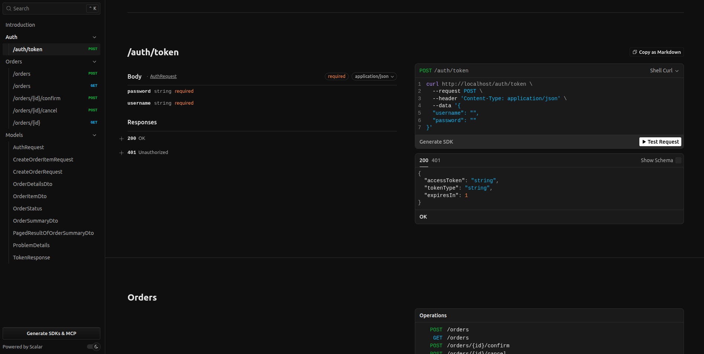
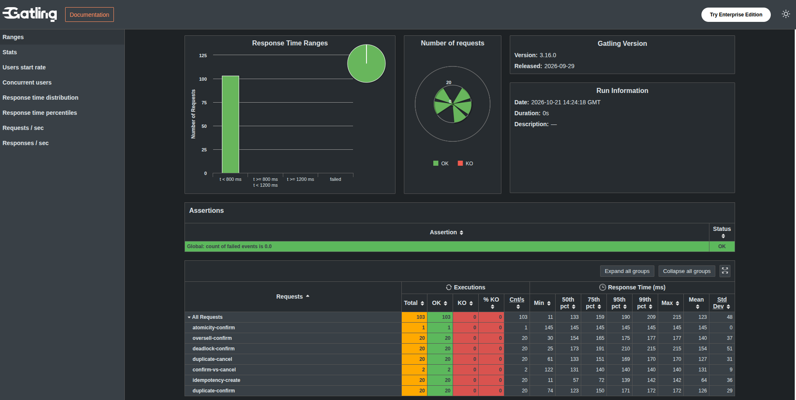

# Order Service

API REST de pedidos em .NET 10, EF Core e PostgreSQL. A solução aplica Clean Architecture, JWT, idempotência distribuída, controle transacional de estoque e consultas paginadas. O ambiente Docker inicia duas instâncias da API atrás de um Nginx e executa migrations/seed uma única vez antes de liberar tráfego.

## Sumário

- [Início rápido](#início-rápido)
  - [Recursos do Compose](#recursos-do-compose)
- [Dados de demonstração](#dados-de-demonstração)
- [Uso da API](#uso-da-api)
  - [Criar pedido](#criar-pedido)
  - [Consultar, confirmar e cancelar](#consultar-confirmar-e-cancelar)
  - [Listar pedidos](#listar-pedidos)
- [Erros](#erros)
- [Desenvolvimento local](#desenvolvimento-local)
- [Testes](#testes)
  - [Consistência distribuída e ACID](#consistência-distribuída-e-acid)
  - [Carga e desempenho](#carga-e-desempenho)
- [Arquitetura](#arquitetura)
- [CI](#ci)
- [Limites conscientes](#limites-conscientes)

## Início rápido

Pré-requisitos: Docker com Compose v2. Para iniciar toda a aplicação:

```bash
docker compose up --build -d
```

Depois do health check:

- API: `http://localhost:8080`
- Scalar: `http://localhost:8080/scalar`
- OpenAPI 3.1: `http://localhost:8080/openapi/v1.json`
- Liveness: `http://localhost:8080/health/live`
- Readiness/PostgreSQL: `http://localhost:8080/health/ready`

Cada resposta contém `X-Instance-Id: api-1|api-2`, permitindo observar o balanceamento. O Nginx usa `least_conn`, equivalente a round-robin quando as conexões têm duração semelhante.

Para encerrar sem apagar o banco:

```bash
docker compose down
```

Para recriar tudo, inclusive o volume PostgreSQL (operação destrutiva para dados locais):

```bash
docker compose down --volumes
docker compose up --build -d
```

### Recursos do Compose

O Compose aplica limites rígidos de CPU e RAM, sem swap, dimensionados para o stress de 100 VUs e para as race conditions:

| Serviço | CPU máxima | RAM máxima |
|---|---:|---:|
| `postgres` | `0.75` | `512 MiB` |
| `api-1` | `2.00` | `512 MiB` |
| `api-2` | `2.00` | `512 MiB` |
| `nginx` | `0.25` | `64 MiB` |
| `migrator` | `0.50` | `256 MiB` |

Durante a operação normal, o teto combinado é de 5 CPUs e 1,56 GiB de RAM. O migrator é one-shot e termina antes de iniciar as APIs. Para reproduzir os thresholds de carga com folga para Docker, sistema operacional e k6, recomenda-se um host com pelo menos 6 CPUs lógicas e 3 GiB disponíveis.

Os números, ambiente e comandos da validação estão no [relatório de recursos e testes](docs/test-results/2026-10-21-resource-limits.md).

## Dados de demonstração

O migrator cria somente os registros ausentes. Reexecuções não restauram estoque e não sobrescrevem usuários ou pedidos.

- Usuários: `user01` até `user10`
- Senha: `Demo@123456` (pode ser alterada com `DEMO_PASSWORD` antes do primeiro seed)
- IDs de usuário: `00000000-0000-0000-0000-000000000001` até `...0010`
- Produtos: `SKU-001` até `SKU-010`
- IDs de produto: `10000000-0000-0000-0000-000000000001` até `...0010`
- Moeda: `BRL`; preço: R$ 10,00 até R$ 100,00; estoque inicial: 100 unidades

Em ambientes compartilhados, defina uma chave JWT forte:

```bash
JWT_SIGNING_KEY='uma-chave-aleatoria-com-pelo-menos-32-caracteres' docker compose up --build
```

## Uso da API

Acesse o painel do Scalar
- Scalar: `http://localhost:8080/scalar`



### Listar pedidos (Observação aos quesitos do desafio)

A listagem é deliberadamente pública e exige `customerId`:

```bash
curl 'http://localhost:8080/orders?customerId=00000000-0000-0000-0000-000000000001&status=Confirmed&from=2026-01-01T00:00:00Z&to=2027-01-01T00:00:00Z&page=1&pageSize=20'
```

- `from` é inclusivo e `to` exclusivo.
- Datas exigem ISO 8601 com `Z` ou offset explícito.
- `page` começa em 1; `pageSize` aceita 1 a 100.
- Ordem estável: `createdAt DESC, id DESC`.
- A resposta contém somente resumos, nunca itens.

Esta exceção pública foi escolhida porque o contrato exige `customerId` na listagem e não define um papel administrativo. Conhecer um ID permite consultar os resumos daquele cliente; isso é um risco aceito apenas para o desafio. Em produção, a listagem deve usar o `sub` e remover o filtro redundante, ou exigir uma policy administrativa explícita. Veja [ADR 0003](docs/adr/0003-authorization-and-public-list.md).

## Erros - Detalhes no Scalar

Falhas esperadas usam `application/problem+json` com `code`, `traceId` e, quando aplicável, `field`:

- `400`: contrato inválido, quantidade, moeda, datas, paginação, produto repetido ou chave ausente.
- `401`: credencial ou JWT inválido.
- `403`: tentativa de criar para outro cliente.
- `404`: pedido ausente ou pertencente a outro usuário.
- `409`: estoque insuficiente, transição inválida ou conflito de idempotência.
- `422`: produto inexistente ou moeda incompatível.

## Testes

`dotnet test` executa testes unitários, de arquitetura e integração. Os testes de integração usam PostgreSQL real via Testcontainers e, portanto, exigem Docker disponível.

```bash
dotnet test OrderService.slnx
```

Categorias cobertas:

- invariantes, total decimal, snapshot de preço e transições;
- fingerprint e criação idempotente;
- limites da Clean Architecture;
- migration e seed reais;
- JWT, propriedade de pedidos e listagem pública;
- retries simultâneos com a mesma chave;
- 20 pedidos disputando 10 unidades, provando ausência de estoque negativo;
- health checks, OpenAPI e Scalar.

### Consistência distribuída e ACID

Os testes xUnit de integração usam uma única instância da API. Para validar o comportamento distribuído real, suba o Compose atual em um terminal:



```bash
docker compose up --build -d
```

Em outro terminal, execute:

```bash
./ops/verify-consistency.sh
```

O script roda o Gatling com JavaScript pelo Nginx em `http://localhost:8080`, confirma por `X-Instance-Id` que as duas APIs participaram e então consulta o PostgreSQL diretamente com `docker compose exec`. Não é necessário publicar a porta do banco nem usar outro arquivo Compose.

A suíte valida:

- criação idempotente simultânea com a mesma chave;
- disputa de 20 pedidos por 10 unidades, sem estoque negativo;
- confirmações e cancelamentos duplicados sem repetir efeitos;
- confirmação contra cancelamento do mesmo pedido;
- rollback atômico de pedido com vários itens;
- contenção entre produtos acessados em ordens opostas;
- totais, estados e estoques persistidos no banco;
- durabilidade após `SIGKILL` e reinício do PostgreSQL.

O teste cria dados identificados por execução. Eles são removidos quando tudo passa e preservados em caso de falha para diagnóstico. O relatório Markdown, o estado observado do banco, as respostas concorrentes e o HTML do Gatling ficam em `TestResults/consistency/<run>/`.

Gatling JS exige Node.js 24 e npm 11. Se as versões instaladas forem anteriores, o script usa versões isoladas via `npx`; a primeira execução pode precisar baixá-las. `BASE_URL` e `DEMO_PASSWORD` podem ser sobrescritas por variáveis de ambiente. Para investigar sem executar o teste destrutivo de durabilidade, use `CONSISTENCY_SKIP_RESTART=1`.

As duas APIs limitam seus pools Npgsql a 40 conexões cada, deixando margem no PostgreSQL para o migrator, health checks e inspeções. Um pooler externo como PgBouncer passa a ser indicado quando o número de réplicas ou de clientes de banco crescer; para duas réplicas fixas, limitar os pools locais evita exceder `max_connections` sem adicionar outra camada operacional.

### Carga e desempenho

Os testes de carga exigem o [k6](https://grafana.com/docs/k6/latest/set-up/install-k6/) instalado na máquina e a aplicação disponível em `http://localhost:8080`. Inicie a stack em um terminal:

```bash
docker compose up --build -d
```

Em outro terminal, execute o smoke:

```bash
k6 run tests/k6/smoke.js
```

Ou execute o stress balanceado de cinco minutos:

```bash
k6 run tests/k6/stress.js
```

Os scripts usam `BASE_URL=http://localhost:8080` e `DEMO_PASSWORD=Demo@123456` por padrão. Para apontar para outro ambiente ou senha, informe as variáveis no próprio comando:

```bash
BASE_URL=http://localhost:8080 \
DEMO_PASSWORD='outra-senha' \
k6 run tests/k6/smoke.js
```

O k6 é executado diretamente no terminal; ele não faz parte do Compose. O stress sobe até 100 VUs, distribui os 10 usuários e mede p95 de leituras abaixo de 500 ms e escritas abaixo de 1 s. Os limites são uma baseline local e devem ser recalibrados com hardware, volume e SLOs reais.

Última execução completa: [resultado dos testes com limites de CPU/RAM](docs/test-results/2026-10-21-resource-limits.md).

## Arquitetura

```text
Domain <- Application <- Infrastructure
             ^               ^
             +------ API ----+
```

- **Domain:** aggregates e invariantes, sem EF/ASP.NET.
- **Application:** casos de uso, DTOs e portas.
- **Infrastructure:** EF Core/Npgsql, queries, autenticação de credenciais e transações.
- **API:** controllers, JWT, Problem Details, documentação e composition root.
- **Migrator:** seed idempotente após o migration bundle.

Consultas usam projeção direta e `AsNoTracking`; a listagem não materializa itens. Índices começam por `customer_id` nas consultas de autorização/filtro. A confirmação bloqueia o pedido com `FOR UPDATE` e baixa cada produto por `UPDATE ... WHERE available_quantity >= quantity`, ordenado por `product_id`. Qualquer falha reverte toda a transação. Cancelamento usa o mesmo lock e ordenação. Deadlocks PostgreSQL repetem a transação inteira no máximo três vezes com jitter.

Diagramas de dados e sequência estão em [docs/architecture.md](docs/architecture.md). As decisões e alternativas estão no [índice de ADRs](docs/adr/README.md).

## CI

O workflow de pull request restaura com lock files, compila com nullable/analyzers e warnings como erros, verifica formatação, executa testes/cobertura, detecta model changes sem migration, gera migration bundle, audita pacotes, constrói o Compose, valida health/OpenAPI/Scalar, executa a suíte distribuída de consistência/ACID, executa o smoke k6 e confirma respostas das duas instâncias. O stress completo é manual.

Dependabot acompanha NuGet, Docker e GitHub Actions. Workflows têm permissões somente de leitura e cancelam execuções antigas da mesma branch.

## Limites conscientes

- Não há reserva temporária, expiração, ajuste administrativo de estoque, carteira ou crédito.
- Não há outbox porque não existem efeitos em brokers/serviços externos.
- Offset pagination atende ao contrato; em páginas profundas, keyset pagination é a evolução indicada.
- A chave de idempotência não expira nesta entrega; produção requer retenção e limpeza.
- O JWT local serve à demonstração. Produção deve usar um IdP, rotação de chaves, secrets manager e policies por escopo/papel.
- Logs não incluem senhas nem tokens; observabilidade distribuída e métricas de negócio são evoluções naturais.
