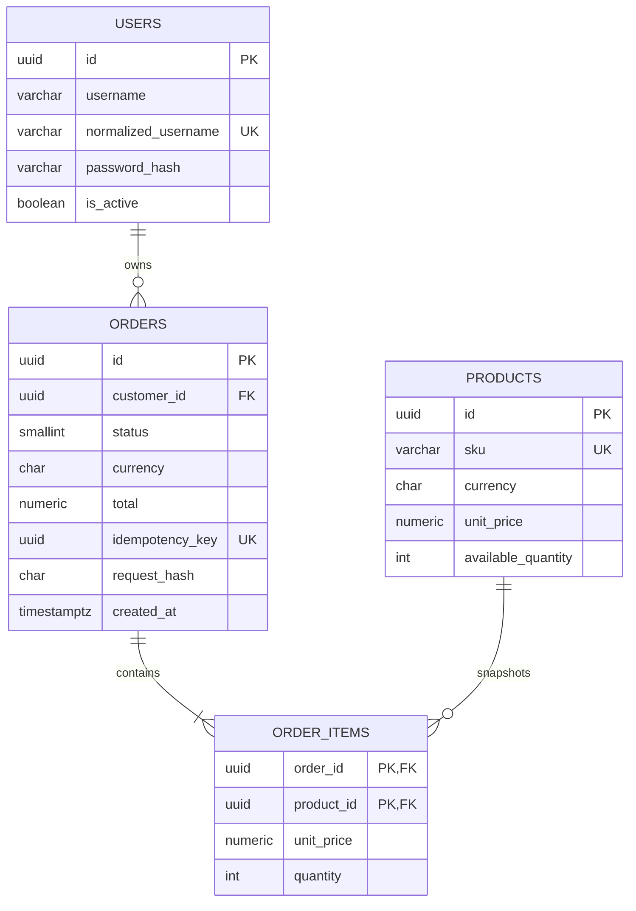
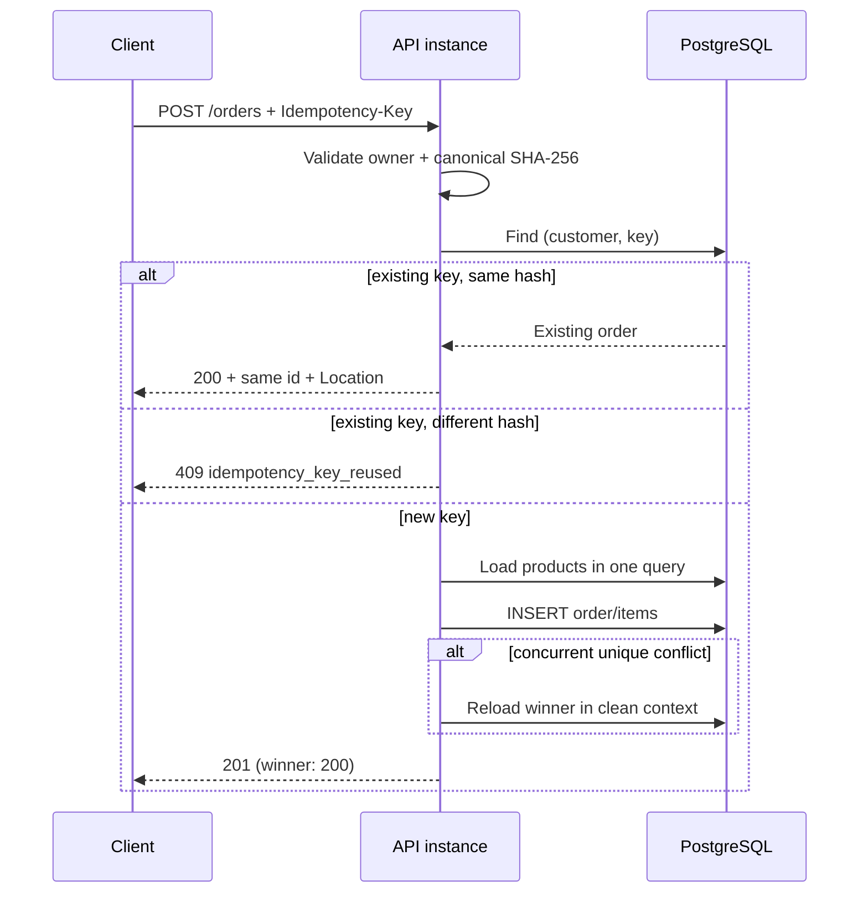
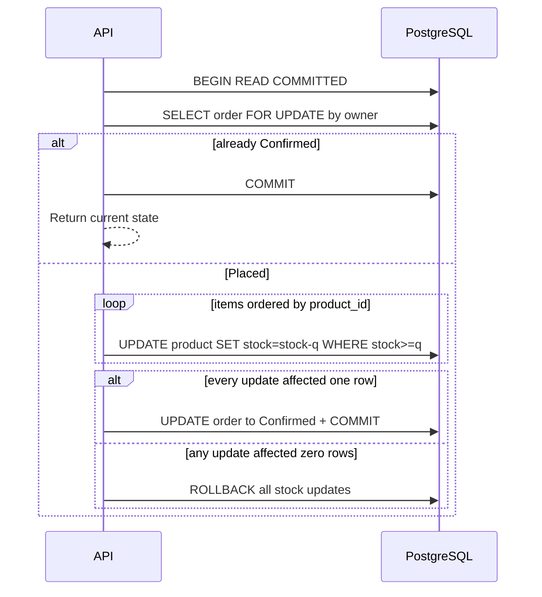
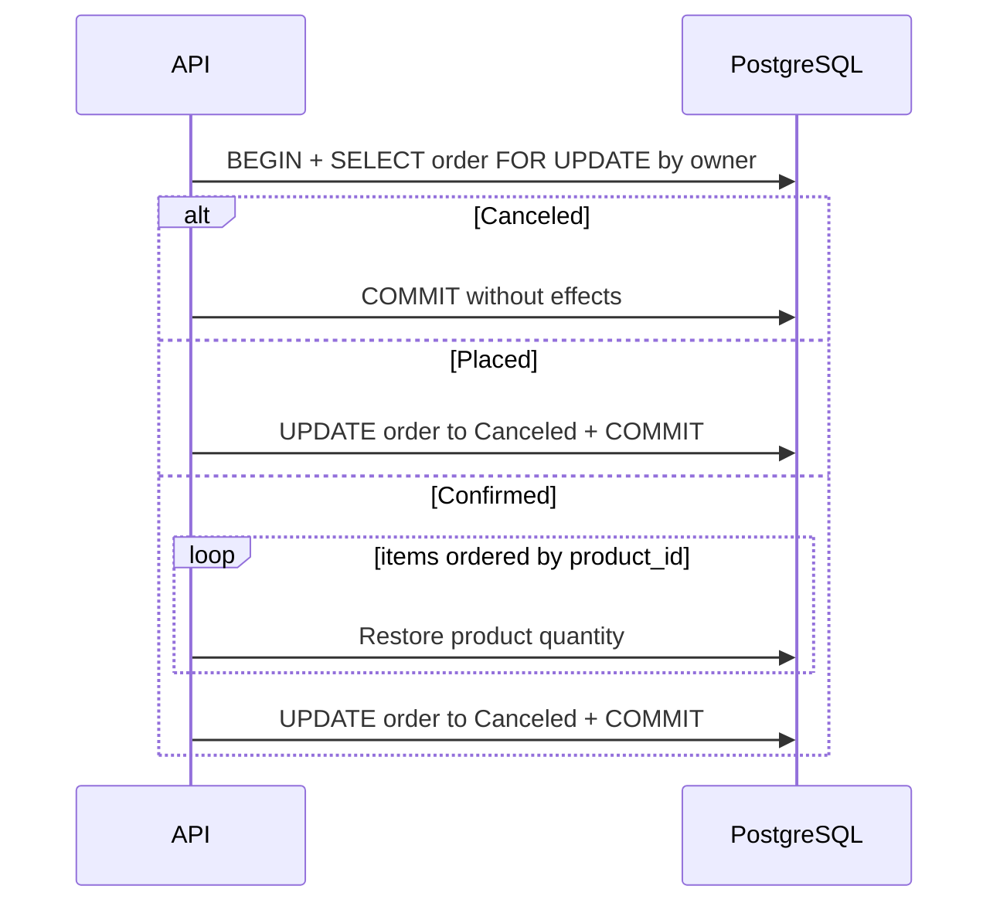

# Arquitetura

## Modelo de dados

## Criação idempotente

## Confirmação

## Cancelamento

Os locks são do PostgreSQL, portanto coordenam todas as instâncias. Não existe mutex em memória. A constraint de estoque e os updates condicionais formam a última linha de defesa contra valores negativos.

